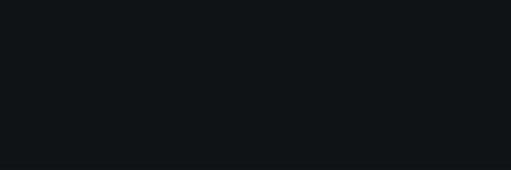

# motion/ — logo animation videos

Remotion project that renders the "si" logo animation as video (site intro,
social posts, video intros). It is a **separate workspace**: its own
`package.json`, lockfile and `pnpm-workspace.yaml`; excluded from the website's
TypeScript, ESLint and Docker build context. Nothing here ships with the site.



## Concept: signal trace

The amber square, the site's only accent and the dot of the i, behaves like a
signal on a circuit. It travels the S at constant speed, drawing the stroke behind
it, is routed to the foot of the i, climbs the stem and decelerates into its final
place. Only arrivals ease (the site's `--ease-out`). Then the name comes into focus
letter by letter while its spacing gathers towards the mark.

| Time (s)    | What happens                                                        |
| ----------- | ------------------------------------------------------------------- |
| 0.00 – 0.30 | Empty background                                                    |
| 0.30 – 1.45 | Signal traces the S                                                 |
| 1.45 – 1.55 | Signal leaves the end of the S and reappears at the foot of the i   |
| 1.55 – 1.80 | Signal climbs the stem                                              |
| 1.80 – 2.20 | Signal decelerates into the dot. **From 2.20 the mark is the logo** |
| 2.25 – 3.60 | Mark glides from the centre to its place in the lockup              |
| 2.45 – 4.13 | Letters come into focus one by one, spacing gathers                 |
| 4.00 – 5.60 | Static, exact logo (1.6 s hold)                                     |

## Exactness

The logo is never redrawn. Its paths come from
[`src/components/brand/logo-geometry.ts`](../src/components/brand/logo-geometry.ts)
(shared with the website), and from the lock frame on the component renders the
logo's plain markup. Mark sizes are snapped to an even number of pixels per
viewBox unit (the dot sits at x = 16.5), so every edge lands on the pixel grid.
The last frame of each format was compared with the source SVG rendered by Chrome
at the same size and position: **0 differing pixels**.

## Change colours or timing

- **Colours, easing, durations** come from the site's tokens: `pnpm tokens` reads
  `@theme` in `src/app/globals.css` into `src/tokens.generated.json` (run
  automatically by `studio` and `render`). Change the token on the site, re-render.
- **Per-render overrides:** every composition accepts props
  (`colors`, `timeline`, `transparent`, `markSize`, `wordmark`), e.g.
  `pnpm exec remotion render LogoReveal out/x.mp4 --props='{"wordmark":"none"}'`.
- **Timeline:** `src/timeline.ts` (seconds; keep at least 1.5 s of static logo).

## Render

```bash
cd motion
pnpm install
pnpm studio                     # preview and scrub in the browser
pnpm render                     # all formats into motion/out/
pnpm render LogoSquare          # one composition only
REMOTION_BROWSER=/usr/bin/google-chrome pnpm render   # use an installed Chrome
```

`pnpm render` produces, for each format (16:9 1920×1080, 1:1 1080×1080,
9:16 1080×1920, all 60 fps, 5.6 s):

- `logo-reveal-<format>.mp4`: H.264, CRF 18, yuv420p
- `logo-reveal-<format>-alpha.webm`: VP9 with alpha (transparent background)

For a ProRes 4444 master for editing:
`pnpm exec remotion render LogoReveal out/logo-reveal.mov --codec=prores --prores-profile=4444 --props='{"transparent":true}'`

The published renders live in [`docs/media/logo/`](../docs/media/logo/).
